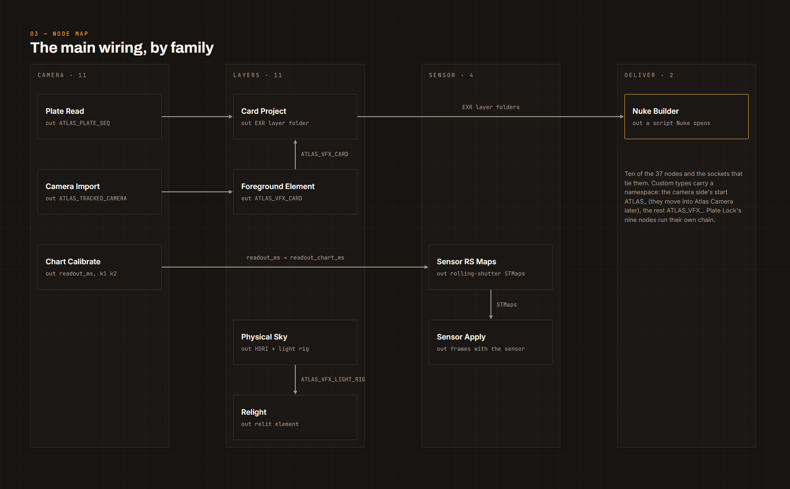
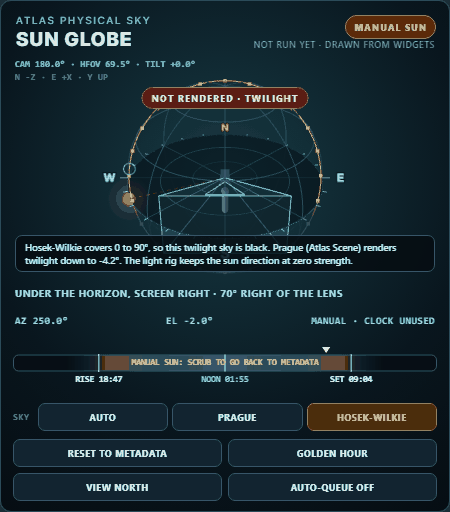
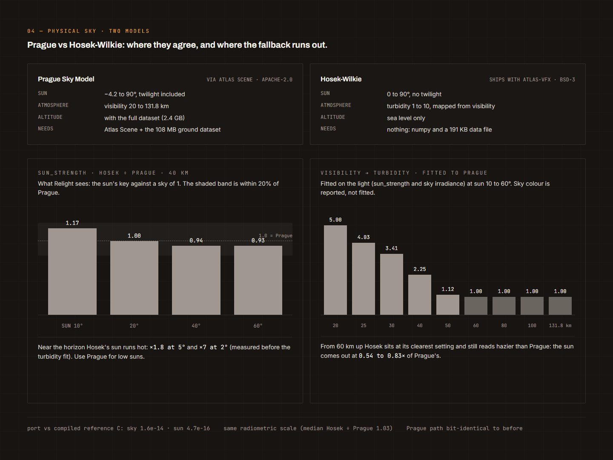

# atlas-vfx

VFX nodes for real plates, for ComfyUI (category `Atlas VFX/...`) and plain Python. MIT licence (see LICENSE). Early: the nodes work on the author's test plates; expect changes.

- `atlas_vfx/camera_side/` plate I/O, tracking, solve and import, scale, lock check, depth, camera export. Moves to Atlas Camera later.
- `atlas_vfx/layers/` set proxy, cards, foreground elements, character insert, relight, physical sky, LTX prep/return.
- `atlas_vfx/sensor/` Sensor Pass: rolling shutter and lens as STMaps.
- `atlas_vfx/platelock/` Plate Lock: lock an AI take back onto its plate.
- `atlas_vfx/deliver/` Nuke builder, comp preview.
- `atlas_vfx/contracts/` shot-camera@0.1 and friends.
- `prototypes/` the scripts that proved it on DSCF3000. Reference only.
- `docs/` the node list (NODE_CATALOGUE.md) and how to make picks (PICKING.md). `docs/dev/` is the working record: the
  plan, notes, upstream asks. `docs/reviews/` holds the spec panel reviews.

Start with AGENTS.md (rules, layout, import graph) and SECURITY.md (threat model, reporting).

## How it fits

Ten of the 37 nodes and the sockets that tie them. Plate Lock's nine nodes run their own chain. The full list, with
every input and output, is `docs/NODE_CATALOGUE.md`.

## Status (0.1.0, beta)

37 nodes ship and load; the catalogue's other 12 entries are planned or live elsewhere. How far each node is
proven:

- **Accepted in Nuke** (3): EXR Write, Nuke Builder, Camera Export.
- **Run on a real plate inside ComfyUI** (19): Plate Read, Tracking Proxy, Camera Import, Solve Compare, Lock Check,
  Plate Depth, Card Project, Foreground Element, Sensor Lens Maps, Sensor RS Maps, Sensor Apply, LTX Prep, LTX
  Return, Comp Preview, Physical Sky, and on an LTX plate: Light Probe & Relight, Normals, Light From Plate, Depth
  Holdout. Measure & Scale and Set Proxy ran on the plate with guessed picks and a guessed scale (2 more).
- **Synthetic only**, tests with a known answer, not yet a real plate (12): the nine Plate Lock nodes, Chart
  Calibrate (the chart isn't shot yet), Character Insert (its plate run was withdrawn), RS Solve.
- **Deprecated** (1): Sensor Readout Solve, biased low on the plate; RS Solve replaces it.

What that means for you: the camera to cards to Nuke path, Sensor Pass and Physical Sky are the solid parts. Plate
Lock works on synthetic plates and is waiting for a real one. The proof column in `docs/NODE_CATALOGUE.md` is the
source; this list follows it.

## Install

- Clone (or junction) this repo into `<ComfyUI>/custom_nodes/atlas-vfx` and restart ComfyUI. The nodes appear under
  `Atlas VFX/Camera`, `Atlas VFX/Layers` (with `Plate Lock`), `Atlas VFX/Sensor` and `Atlas VFX/Deliver`.
- `requirements.txt` is what ComfyUI Manager installs (numpy, scipy, opencv-python, opencolorio, jsonschema,
  OpenImageIO; bounds in `pyproject.toml`). One optional extra, by hand into the ComfyUI venv: `pycolmap==4.2.1` for
  COLMAP import. Nodes load without it and say what to install when queued;
  `docs/NODE_CATALOGUE.md` lists what each node needs.
- `ffmpeg` and `ffprobe` on PATH (plates are decoded as native planes; the colour maths is in numpy).
- Tests: `python tests/run_all.py` with the ComfyUI venv's python runs every `tests/test_*.py` as a script
  (about 7 minutes; `python tests/run_all.py plate camera` filters by name). No pytest.
- Physical Sky renders a sky out of the box (the Hosek-Wilkie model that ships here). With the author's Atlas
  Scene and a Prague Sky Model dataset it uses Prague instead (`sky_model`: auto, prague, hosek-wilkie).
- Point the nodes at your own plate with the `path` widget of Plate Read (`~` expands) and your camera with
  Camera Import (Nuke JSON or .chan, Alembic, a COLMAP model, or a shot-camera JSON).

## First run

1. Install (above), restart ComfyUI.
2. Load `workflows/starter_physical_sky.json` (drag it onto the canvas) and queue it. No plate, no other packs: it
   renders the sky for a beach south of Sydney at 6:39 pm on 25 Dec 2025 as a 1024 px ACEScg lat-long EXR under
   `~/atlas-vfx-work/physical_sky/`, with the Sun Globe panel on the node.
3. Then point Plate Read at your own plate and Camera Import at your camera; the other workflows in `workflows/` show
   the graphs (they were saved on the author's footage, so re-point their paths).

`tools/clean_install_check.py` does step 2 in a ComfyUI that has never seen your machine (a fresh clone, empty home
folder); CI runs it on Linux on every push.

## Physical Sky

The Sun Globe panel sits on the Physical Sky node: the sun, the day's path and the camera on a globe. Drag the sun,
scrub the hour, jump to golden hour, pick the sky model. Here the sun is 2 degrees under the horizon with
Hosek-Wilkie picked. Hosek stops at the horizon, so the panel says the sky won't render and why, before you queue.
The panel only drives the node's own widgets: a headless run is the same without it.

Two sky models. Prague (through Atlas Scene) is the quality path: twilight, altitude, visibility. Hosek-Wilkie ships
here and needs nothing. Fitted to Prague, its sun lands within about 10% of Prague's from 20 to 60 degrees at 20-50 km
visibility; near the horizon and in very clear air it drifts, so use Prague there. The numbers come from
`atlas_vfx/layers/data/hosek_visibility_turbidity.json`.

## Where things go

- Nodes write under `~/atlas-vfx-work` (`ATLAS_VFX_WORK` moves it; `ATLAS_VFX_OUT_ROOTS`, `os.pathsep`-separated,
  allows more folders). An `out_dir` anywhere else, inside the repo, or next to the plate is refused: ComfyUI's API
  has no auth, so widgets are not trusted.
- Path widgets expand `~` and `%VARS%`. A blank `ocio_config` means the shipped `config/atlas_aces2.0_studio_flog2.ocio`.
- `workflows/*.json` document the DSCF3000 runs with the home folder written as `~`; they run unchanged on a
  machine with the same layout under its own home folder, else re-point the plate and camera widgets.
- `tests/test_hygiene.py` keeps the shipped tree free of user folders and LAN addresses; machine notes stay in
  untracked `*.local.md` files.
