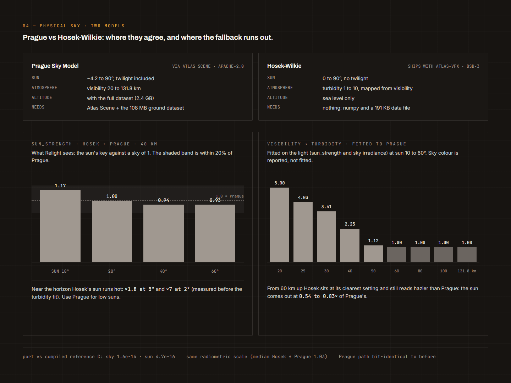
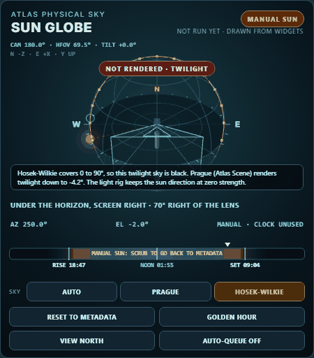

# 02 Physical Sky: a real sun and sky from where and when you shot

Hands-on: `docs/learn/exercises/02_physical_sky.py` (runs in under a second, no plate, no GPU).

## 1. What it's for

You shot a plate somewhere, at some time. The camera wrote GPS and a timestamp. That's enough to know exactly where
the sun was, and from there a physically based clear sky. **Atlas VFX Physical Sky** (catalogue 48) turns those two
facts into three things a comp needs:

- an **HDRI**: a scene-linear, unclipped, float32 ACEScg lat-long of the clear sky and the sun disc, written as an
  EXR with a sidecar, ready for a dome light or a reflection pass;
- a **light rig** (`ATLAS_VFX_LIGHT_RIG`): the sun's direction per frame in the camera's own space, its colour, and
  how hard it is against the sky, which Relight plugs in to replace a guessed sun;
- a **preview** through a named OCIO display and view, with the sun ringed and the camera's field of view marked.

Think of it as the sun-and-sky half of a lighting reference, made from metadata rather than a chrome ball. It won't
give you clouds, buildings or bounce from the set: it's a clear-sky model. What it gives you is the one thing a
chrome ball often can't, which is the sun's exact direction and its strength relative to the sky, at any hour you
like (`time_offset_h` relights the same place to a different time).

A second node, **Atlas VFX Sun Direction** (catalogue 56), reads that rig and says where the sun is in words
("the right", "low") for the LTX Relight IC-LoRA, and **Atlas VFX Light Ball** (57) pastes the matching
light-direction ball onto the reference frames. That's how the real sun steers a generative relight.

## 2. The mental model

```
 GPS (lat, lon)  +  capture time (ISO, with offset)  [+ time_offset_h]
                │
                ▼  layers/solar.py: NOAA solar position (geometric, no refraction)
        sun azimuth / elevation  (compass, deg)  ── sun_mode: metadata | offset (+ nudge) | manual
                │
     ┌──────────┴───────────────────────────┐
     ▼                                      ▼
 sky model (sky_model widget)          camera (typed heading/fov/tilt, or a tracked shot camera)
   prague: Atlas Scene (optional)           │  sun_in_camera(): sun direction per frame,
   hosek-wilkie: shipped fallback           │  OpenGL camera space (x right, y up, looking down -Z)
     │                                      │
     ▼                                      ▼
 Linear Rec.709 radiance ──► E_sun, E_sky_up (irradiance) ──► light_rig (sky = 1, sun_strength, sun_dir)
     │                                                           │
     ▼ OCIO "Linear Rec.709 (sRGB)" -> "ACEScg"                  ├─► Relight sun_rig (2.5D relight)
 hdri_acescg (lat-long EXR) + preview (OCIO display/view)        └─► Sun Direction -> Light Ball -> LTX relight
```

Two separate questions live in that diagram, and it helps to keep them apart. **Where is the sun?** is pure
astronomy, and the repo answers it itself. **What does the sky look like?** needs a sky model, and there are two.

## 3. How it works

### 3.1 Where the sun is: `atlas_vfx/layers/solar.py`

`solar.sun_at(latitude, longitude, when)` is NOAA's compact solar position algorithm (Meeus, via the NOAA solar
calculator spreadsheet), pure python. It returns compass azimuth (degrees clockwise from true north: 0 N, 90 E,
180 S, 270 W) and elevation above the horizon. The angles are **geometric**: no atmospheric refraction, the same
choice Prague and Atlas Scene make.

The numbers it has been held to:

| check | result | where |
|---|---|---|
| NREL SPA published case (Reda and Andreas 2004), refraction and parallax taken out | +0.0023 deg az, -0.0019 deg el | `tests/test_physical_sky.py: test_noaa_vs_published`, NOTES 2026-10-28 |
| Atlas Scene's own `derive_sun`, 204 suns | same numbers to 0 deg | NOTES 2026-10-28 |
| DSCF2977 at Burning Palms, 6:39 pm AEDT, 25 Dec 2025 | az 252.355, el 16.121 | `test_noaa_known_shot` |

Why does atlas-vfx carry its own NOAA rather than calling Atlas Scene? Because `derive_sun` refuses elevations below
-4.2 deg (the Prague sky's domain), and a relight still needs the direction of a sun that's gone under the horizon.

`solar.parse_utc` is strict on purpose. A capture time must name its offset (`2025-12-25T07:39:25Z` or
`2025-12-25T18:39:25+11:00`); a bare `2025-12-25T18:39:25` is refused, because an hour of ambiguity moves the sun
15 degrees. Camera clocks lie about time zones all the time, so this is the right place to be fussy.

`physical_sky.effective_sun` adds the artist modes on top:

- `metadata`: the NOAA sun at capture time plus `time_offset_h`;
- `offset`: that, plus `sun_azimuth_offset` / `sun_elevation_offset` (a nudge);
- `manual`: `sun_azimuth` / `sun_elevation` exactly as typed (the capture time is only recorded).

`physical_sky.sun_path` samples the capture's whole solar day every 10 minutes and finds the events on `sun_at`
itself: sunrise and sunset (elevation crossing 0, bisected), solar noon (highest sun, ternary search) and golden hour
(the sun crossing 4 deg, `GOLDEN_ELEVATION`), plus polar day or night when there's no sunrise. The Sun Globe draws
this path.

### 3.2 What the sky looks like: Prague or Hosek-Wilkie, and who owns what

There are two sky models, picked by the `sky_model` widget (`auto`, `prague`, `hosek-wilkie`):

| | Prague | Hosek-Wilkie |
|---|---|---|
| owned by | **Atlas Scene** (its `environment` package and the `atlas_scene_prague` extension wrapping the official Prague Sky Model) | **atlas-vfx**: `atlas_vfx/layers/sky_hosek.py` |
| how atlas-vfx reaches it | only through `atlas_vfx/_atlas_scene.py`, lazily; nothing copied | numpy and the standard library, never imports Atlas Scene |
| needs | Atlas Scene, its compiled Prague extension, a Prague `.dat` dataset (ground level, about 103 MB, is enough) | nothing: ships with the repo (a 191 KB `.npz` of the authors' coefficients, hash-checked) |
| sun range | down to -4.2 deg (renders twilight) | 0 to 90 deg (no twilight) |
| haze | `visibility_km` 20 to 131.8 directly | `visibility_km` mapped to turbidity 1 to 10 by a table fitted to Prague |
| altitude | used with the full dataset | sea level only |
| licence | Apache-2.0 (model and dataset) | BSD-3-Clause, see `layers/data/THIRD_PARTY_HOSEK_WILKIE.md` |

`auto` (the default) renders Prague when Atlas Scene, its extension and a dataset are all reachable, else
Hosek-Wilkie, and says why in `info`, the sidecar, the EXR header (`sky_model`) and the log
(`node_physical_sky.choose_model`). Asking for `prague` when it isn't there raises `AtlasSceneMissing` with the
install steps, but only if a sky actually has to be rendered.

The split exists because the repo is public and Atlas Scene isn't (NOTES 2026-10-29). Before the fallback,
Physical Sky simply failed for everyone else. The rule since: Atlas Scene owns Prague, atlas-vfx owns one analytic
fallback, and nobody copies Atlas Scene's sky code. `_atlas_scene.py` looks for Atlas Scene in this order: already
imported, `ATLAS_SCENE_ROOT`, installed into this Python, then `~/atlas-scene-DEV/atlas-scene`. The dataset comes
from the node's `dataset` widget or `ATLAS_PRAGUE_DATASET`.

How close is the fallback? From the catalogue and NOTES (fitted by `tools/hosek_calibrate.py`):

- at 20 to 50 km visibility with the sun 20 deg up, the rig's `sun_strength` is within about 10% of Prague's and the
  sky within about 25%;
- above about 60 km Hosek can't get as clear as Prague (turbidity bottoms out at 1): `sun_strength` 0.55 to 0.85 of
  Prague's;
- near the horizon (2 to 5 deg) its sun is far too bright: x1.8 at 5 deg, x7 at 2 deg;
- the absolute scale matches: median Hosek/Prague 1.03, so `exposure_ev` means the same thing in both.



### 3.3 Frames: the sky frame, the lat-long, the camera

This is the bit that bit (NOTES 2026-10-28). Three frames, all in `atlas_vfx/layers/physical_sky.py`:

**Sky frame.** Right-handed, Y up, north = -Z, east = +X. A compass azimuth A and elevation e give
`d = (sin A cos e, sin e, -cos A cos e)` (`azel_to_dir`). So N is (0, 0, -1), E is (1, 0, 0).

**Lat-long.** Nuke's layout, seen from inside: the centre column looks down -Z, +X is a quarter to the right, +Y is
the top row. With `latlong_centre` = north the centre column is north; with `camera heading` it's the camera's
heading. **Azimuth grows to the right** (north, east, south, west), as you'd see turning right on the spot. A sun at
(A, e) lands at `x = ((A - centre + 180) mod 360) / 360 * W - 0.5`, `y = (90 - e) / 180 * H - 0.5` (`sun_pixel`,
pixel centres on integers). The EXR carries this convention as a header attribute.

**The mirror.** Atlas Scene's Prague boundary maps its (x, y, z) to Prague's (x, -z, y) and hands the compass
azimuth straight in, so in Atlas Scene's own lat-long the sun sits at `x = (270 - A) / 360 * W`: azimuth grows to the
LEFT. That's the mirrored render Mike hit on 2026-10-28. The fix is one 3x3 with determinant -1
(`latlong_to_atlas`), applied to the directions before Atlas Scene's evaluator sees them (`class _Oriented`). No
resampling, so the radiance is still exactly Atlas Scene's. The Hosek-Wilkie evaluator uses Atlas Scene's evaluator
contract too (so Atlas Scene could register it later), and goes through the same `_Oriented` wrapper. The test pins
the brightest pixel of a 2048 render to within 1.2 px of the predicted sun, never the mirrored column.

**Camera.** OpenGL camera space, which is what Relight expects: x right, y up, the camera looking down -Z.
`camera_to_sky(heading, tilt)` builds a level camera from a compass heading and a tilt; `sun_in_camera` turns the sun
into that space.

### 3.4 How the tracked camera orients the sky

A solved camera knows how it turned, but not which way is north. So you tell it: `heading_deg` is the compass
direction the camera faces **on its first frame**. With a `shot_camera` connected (`ATLAS_TRACKED_CAMERA`,
shot-camera@0.1, Y up), `sun_in_camera` measures the compass angle of the first frame's view in the solve's world,
turns the whole world about Y by the difference (`world_yaw_deg` in info), then applies every frame's own rotation.
Pans and tilts in the solve follow through to the sun direction per frame; `tilt_deg` is ignored (the solve's tilt
wins) and `fov_x` comes from the camera's intrinsics.

The practical upshot: the sun's direction relative to the camera is only as good as the heading you type. On the
DSCF3000 tracked relight the heading of frame 1001 is still a 180 placeholder (NOTES 2026-11-01), so treat that one as
illustrative until it's measured.

### 3.5 Units, colour and what a pixel value means

Both models return **unclipped scene-linear Linear Rec.709** radiance in **radiometric CIE-weighted units**:
spectral W/(m^2 sr nm) integrated against the CIE 1931 observer, without the 683 lm/W (multiply Y by
`sky_hosek.LM_PER_W` = 683 for cd/m^2). The Hosek port builds its RGB from 11 spectral bands through the Wyman,
Sloan and Shirley 2013 fit of the CIE colour matching functions (`cmf_wyman2013`, checked against colour-science's
tables: max error 0.024, integrals within 0.1%).

So a pixel value is a physical radiance on an absolute scale, not a display value. In the exercise the zenith of a
16 deg evening sky reads about 2 and the sun disc over a million. That's why everything stays float32: half float
overflows on the sun disc (65504 max).

Then, the colour hop. The sky leaves the model in Linear Rec.709 and goes to the working space by a **named OCIO
transform** with the shipped config: `physical_sky.to_working` runs `"Linear Rec.709 (sRGB)" -> "ACEScg"`
(`config/atlas_aces2.0_studio_flog2.ocio` when the `ocio_config` widget is blank). The EXR says `ACEScg` in its
header, plus `source_colorspace`. The preview is a separate, display-referred hop, `ACEScg -> display / view`
(default `sRGB - Display` / `ACES 2.0 - SDR 100 nits (Rec.709)`), auto-exposed so the median sky sits at 0.18.
None of that touches the HDRI.

`exposure_ev` multiplies the HDRI by 2^ev and nothing else: the light rig is normalised, so it doesn't change.

Two energy details worth knowing:

- **The rig integrates the sun, the HDRI samples it.** The disc is about 0.5 deg wide, roughly 3 px at 2K. The HDRI
  point-samples pixel centres, so its share of the sun's energy wobbles with where the disc lands
  (`hdri_sun_energy` in info: 1.06 for DSCF2977 at 2048 under Prague, 0.99 in the exercise at 1024 under Hosek), and
  below about 1K the disc can be missed. The rig's sun irradiance is integrated properly (`_sun_irradiance`, 81 x 81
  samples over the disc), so the rig is right even when the HDRI's disc is a little off.
- **The ground.** Below the horizon both renders fill a flat Lambertian ground,
  `albedo / pi * (E_sky_up + E_sun * sin(el))`. Our Hosek render adds the sun analytically there; Atlas Scene's
  renderer fills it from the irradiance its pixels caught, so at low widths it can miss the sun (noted for upstream
  in `docs/dev/UPSTREAM_TODO.md`).

### 3.6 The light rig, and how the sky feeds relight

`physical_sky.light_rig` makes the `ATLAS_VFX_LIGHT_RIG` dict that Light From Plate also makes and Relight reads.
It's **normalised so the sky ambient on an up-facing surface has luminance 1**:

| key | what it is |
|---|---|
| `sky` | `E_sky_up / pi`, per frame (luminance 1 by construction) |
| `ground` | `albedo / pi * (E_sky_up + E_sun sin(el))`, same scale |
| `sun_colour` | `E_sun / max channel` (max channel 1) |
| `sun_strength` | max channel of `E_sun / pi`, same scale: the physical key a surface facing the sun gets against a sky of 1 |
| `sun_dir`, `sun_uv`, `sun_in_front` | per frame, OpenGL camera space and its projection |
| `sun_elevation_deg` | above the horizon, for Sun Direction's low / mid / high |

For DSCF2977 (16 deg sun, 40 km) Prague gave `sun_strength` 7.07 (NOTES 2026-10-28); the exercise gets 7.32 from
Hosek. A sun under the horizon, or a black sky, gives zero colour and strength but keeps the exact direction.

Two consumers:

**Relight (catalogue 18, 2.5D, normal-based).** Its optional `sun_rig` input takes Physical Sky's `light_rig`.
`relight.override_sun` swaps in the physical sun's direction and colour and **keeps the plate's ambient** (sky and
ground measured from the plate by Light From Plate). `sun_strength_from` chooses the key: `sun_gain` as before, or
`physical sky`, where `relight.physical_sun_gain` sets `sun_gain = trim x sun_strength x plate sky luminance`. In
words: the sun is as many times brighter than the plate's own sky as physics says, with `sun_gain` left as a trim
(1 = physical). Unconnected, Relight is unchanged (the test checks it bit for bit).

**Sun Direction (56) and Light Ball (57), for the LTX relight.** The LTX-2.3 Relight IC-LoRA doesn't take a vector.
It takes a light-direction ball pasted top-right on the reference and a prompt. `node_sun_direction.from_light_rig`
reads the rig's sun at the first, middle or last frame, takes `atan2(x, z)` in camera space (0 = behind the camera,
which lights the scene from the front; +90 = right), snaps it to one of 8 sectors 45 deg wide ("the front",
"the front-right", "the right", ... "behind" is a sun in view, so backlight), and picks low / mid / high from
`sun_elevation_deg` (under 32.5, under 57.5, above). It also does the **mirror trick**: on DSCF3000 the LoRA only ever
lit from frame right, so a sun with "left" in it is asked for as the right with LTX Prep's mirror on, and LTX Return
flips the take back (NOTES and the catalogue, 2026-10-30).

### 3.7 The Sun Globe panel (display only)

`web/atlas_vfx_sun_globe.js` puts a three.js globe (r185, vendored in `web/lib/`) under the Physical Sky node: the
sky frame with N E S W, the sun, the capture day's path (amber above the horizon, dim below, hourly dots), the camera
frustum and a little actor lit by the sun, throwing its shadow. A line underneath says it in words (backlit, lit
from screen left or right, front-lit, in frame or not), with AZ / EL / clock readouts and a BELOW HORIZON flag.

It is **display only**. The native widgets stay the contract; the panel just drives six of them
(`time_offset_h`, `sun_mode`, both offsets, `sun_azimuth`, `sun_elevation`) and reads the rest. A headless or API run
is identical with or without it, and with no WebGL the node just shows its normal widgets. The drag mapping:

- dragging the sun writes **manual** (az / el as dropped, to 0.1 deg); from offset mode it stays offset and rewrites
  the offsets;
- the time scrubber writes `time_offset_h` over the capture's solar day, snapping to 5 minutes;
- RESET TO METADATA, GOLDEN HOUR (the clock to the 4 deg sun), VIEW NORTH / VIEW CAMERA, and a sky model switch;
- nothing queues while dragging; AUTO-QUEUE (off by default) queues once when an interaction ends.

After a run, the node sends `ui.atlas_sun_globe[0]` (`node_physical_sky.globe_ui`): the sun used, the NOAA sun
before offsets, the day's path and events, the camera used, and the preview as a JPEG that textures the upper half
of the globe. Before a run, the panel draws from the widgets with a line-for-line JS mirror of `solar.py`;
`tests/test_sun_globe.py` runs both and compares.



## 4. The nodes

From `docs/NODE_CATALOGUE.md`:

**48 Physical Sky** `AtlasVFXPhysicalSky`, Atlas VFX/Layers

| widget / socket | what to put in it |
|---|---|
| `latitude`, `longitude` | GPS, degrees north / east (typed when the file has none). Defaults are Burning Palms. |
| `altitude_m` | Prague full dataset only; ignored (and noted in info) otherwise |
| `capture_utc` | ISO 8601 **with its offset**: `...Z` or `...+11:00` |
| `time_offset_h` | relight to another hour (-48 to 48) |
| `heading_deg` | compass direction the camera looks on its first frame (0 N, 90 E) |
| `fov_x`, `tilt_deg` | typed camera only; a shot camera's own fov and rotation win |
| `visibility_km` | 20 (hazy) to 131.8 (very clear); Hosek maps it to turbidity |
| `ground_albedo` | 0 to 1, default 0.25 |
| `exposure_ev` | HDRI only, the rig is normalised |
| `sun_mode` + offsets + manual az / el | metadata, offset or manual (see 3.1) |
| `width` | lat-long width, multiple of 4, height = width / 2 |
| `latlong_centre` | north or camera heading |
| `name`, `out_dir` | blank `out_dir` = `~/atlas-vfx-work/physical_sky/<name>` (outputs are confined to the work root) |
| optional `shot_camera` | `ATLAS_TRACKED_CAMERA` from Solve Plate / Camera Import / Measure & Scale |
| optional `dataset`, `ocio_config`, `display`, `view` | Prague `.dat`; blank OCIO = the shipped config |
| optional `sky_model` | auto, prague, hosek-wilkie. It's the **last** widget on purpose: saved GUI graphs fill widgets by position |

Outputs: `hdri_acescg` IMAGE, `light_rig` ATLAS_VFX_LIGHT_RIG, `preview` IMAGE, `info` STRING (JSON), `exr_path`.
Writes `<name>.exr` (float32 ACEScg lat-long) plus `<name>.sidecar.json`. Tests: `tests/test_physical_sky.py`,
`tests/test_sky_hosek.py`, `tests/test_sun_globe.py`.

**18 Relight** `AtlasVFXRelight`: optional `sun_rig` (ATLAS_VFX_LIGHT_RIG) and `sun_strength_from`
(sun_gain | physical sky).

**56 Sun Direction** `AtlasVFXSunDirection`, Atlas VFX/Artist: `direction` (8 choices), `height` low / mid / high,
`look` (the light in words), `mirror_trick` auto / off; optional `light_rig` and `rig_frame` (middle / first / last).
Out: `mirror` BOOLEAN (to LTX Prep), `prompt` STRING, `sun` ATLAS_VFX_SUN (to Light Ball).

**57 Light Ball** `AtlasVFXLightBall`: pastes the ball (143/1280 of the width, 22/1280 in from the top-right, the
training layout) on every reference frame. The 24 balls ship in `assets/relight_balls` (MIT).

## 5. Walkthrough with the shipped graphs

**Start here: `workflows/starter_physical_sky.json`.** One Physical Sky node into a Preview Image. It's the
DSCF2977 check shot (Burning Palms, `2025-12-25T07:39:25Z`, heading 180, 69.5 deg fov, 40 km), width 1024,
`sky_model` auto. It needs no plate and no Atlas Scene.

1. Drag it into ComfyUI and queue it. On a machine without Atlas Scene the info says
   `sky_model ... auto: Prague unavailable (...); rendered with Hosek-Wilkie`. That's expected.
2. The preview shows the lat-long through the ACES 2.0 SDR view, auto-exposed, the sun ringed in magenta at about
   WSW, 16 deg up, and yellow lines marking the camera's horizontal field of view around south. The sun is outside
   the lines: on this heading it's off frame right.
3. Open `info`. Look for `sun.azimuth_deg` 252.355 and `elevation_deg` 16.121, `relative_to_heading_deg` (about
   +72), `latlong.sun_pixel`, `colour.transform` (`OCIO Linear Rec.709 (sRGB) -> ACEScg`), and `light_rig.sun_strength`.
4. Grab the sun on the globe and drag it: `sun_mode` flips to manual. Hit RESET TO METADATA, then GOLDEN HOUR, and
   queue again. Scrub the clock past sunset: below 0 deg the Hosek sky is refused (black HDRI, a warning naming
   Prague), but the rig still holds the exact sun direction.
5. Load the EXR (`exr_path`) in Nuke as ACEScg and put it on a SphericalTransform or an environment light. North is
   the centre column, so line it up with your scene's north.

`workflows/physical_sky_dscf2977.json` is the same shot at 2048. It predates the `sky_model` widget (24 values),
which is exactly what `test_widget_order` uses to prove old graphs still load.

**The tracked relight: `workflows/relight_tracked_dscf3000_s2s3.json`** (built by
`tools/relight_tracked_workflow.py`). This one shows where the sky goes in a real shot: Plate Read, Solve Mask, Solve
Plate, Measure & Scale (metres), Sensor Lens Maps (clean space), then Physical Sky at the plate's capture time
(`2025-12-25T07:58:19Z`, from the file's creation time) with the **tracked camera** wired into `shot_camera` and
`latlong_centre` = camera heading. Its `light_rig` goes into Sun Direction (`rig_frame` middle), which feeds the
prompt, the mirror and Light Ball, ahead of the LTX relight of the whole comp. It's heavy (a full tracker and LTX
pass) and uses the owner's plate, so read it for the wiring. Remember the heading there is still the 180 placeholder.

## 6. Hands-on: the exercise

From the repo root, with the ComfyUI venv's python (it needs numpy and PyOpenColorIO):

```
python docs/learn/exercises/02_physical_sky.py
```

It walks ten steps with synthetic inputs (a place, a time, a typed camera, a two-frame synthetic shot camera),
renders a 1024 Hosek-Wilkie sky in memory, writes nothing, and exits non-zero if a check fails. What we got on ws
(about half a second):

```
1. A capture time must say which clock it is in
   ok   '...07:39:25Z' and '...18:39:25+11:00' are the same instant  (2025-12-25T07:39:25+00:00)
   ok   a bare time is refused  (capture time '2025-12-25T18:39:25' has no offset; add Z for ...)

2. Where is the sun? NOAA's algorithm (layers/solar.py), checked against simple astronomy
   Sydney summer solstice: solar noon 2025-12-21T01:53:09Z UTC, sun az 360.00, el 79.57 (simple astronomy says 79.57)
   ok   summer solstice noon elevation matches 90 - |lat - decl|
   ok   summer solstice noon sun is due north (Sydney is south of the tropic)  (359.999)
   sunrise 2025-12-20T18:45:20Z  sunset 2025-12-21T09:00:57Z  evening golden hour (sun at 4.0 deg) 2025-12-21T08:39:18Z
   Sydney winter solstice: solar noon 2025-06-21T01:56:56Z UTC, sun az 0.00, el 32.69 (simple astronomy says 32.69)
   ok   winter solstice noon elevation matches 90 - |lat - decl|
   ok   winter solstice noon sun is due north (Sydney is south of the tropic)  (0.0)
   sunrise 2025-06-20T21:04:34Z  sunset 2025-06-21T06:49:19Z  evening golden hour (sun at 4.0 deg) 2025-06-21T06:27:01Z
   DSCF2977 (Burning Palms, 6:39 pm AEDT): az 252.355, el 16.121
   ok   matches the repo's pinned DSCF2977 sun (252.355 / 16.121)

3. The sky frame and the lat-long layout (the part that bit on 2026-10-28)
   N on the horizon -> [0.0, 0.0, -1.0]
   E on the horizon -> [1.0, 0.0, -0.0]
   S on the horizon -> [0.0, 0.0, 1.0]
   W on the horizon -> [-1.0, 0.0, 0.0]
   ok   right-handed, Y up: north -Z, east +X, south +Z, west -X
   ok   north is the centre column, east a quarter to the RIGHT (azimuth grows right)  (north x 1023.5, east x 1535.5)
   ok   latlong_centre 'camera heading' puts the heading in the middle column
   ok   our frame -> Atlas Scene's Prague frame is a mirror (det -1), handled by _Oriented

4. The sun as the camera sees it (typed camera: heading + fov + tilt)
   camera faces south (heading 180); sun in OpenGL camera space x +0.915 y +0.278 z -0.291
   ok   a WSW sun is to the right, above, and in front (camera looks down -Z)
   projected: u 2.77, v -0.72; in front True  (u > 1 means off frame right)
   ok   72 deg off the lens with a 69.5 deg lens: the sun is off frame right
   shot camera: fov_x 72.6 deg from 16 mm on 23.5 mm; world turned -180.00 deg so frame 1001 faces south; sun u 2.641 -> 5.572 as the camera pans left
   ok   panning the camera left pushes the sun further to frame right

5. Render a Hosek-Wilkie sky (no Atlas Scene needed) and look at the pixels
   1024x512 in 0.3 s; visibility 40 km -> turbidity 2.246
   brightest pixel (205, 210) lum 1471059.0; predicted sun pixel (205.3, 209.6); max over the sky 1988053.5 (way over 1: scene-linear, not display)
   ok   the brightest pixel is where the azimuth / elevation say
   ok   below the horizon: one flat Lambertian ground colour  ([3.4, 3.074, 2.768])
   sky luminance: 5 deg from the sun 24.276, 90 deg round 7.297, zenith 2.125, low horizon opposite the sun 19.392
   ok   the circumsolar glow: the sky is much brighter near the sun
   sun irradiance E_sun [115.19, 79.93, 40.51], sky on an up-facing card E_sky_up [10.74, 16.44, 23.54]  (Rec.709, radiometric CIE-weighted units)
   HDRI holds 0.99 x the sun's true energy (point-sampled disc; the rig integrates it)

6. Haze: visibility_km -> Hosek turbidity, and what it does to the light
   visibility  20.0 km -> turbidity 5.00: sun_strength 4.14, zenith blue/red 2.58
   visibility  40.0 km -> turbidity 2.25: sun_strength 7.32, zenith blue/red 3.81
   visibility 100.0 km -> turbidity 1.00: sun_strength 8.52, zenith blue/red 3.93
   ok   hazier air = higher turbidity
   ok   clearer air = a harder sun against its sky (bigger sun_strength)
   ok   clearer air = a bluer zenith

7. The light rig Relight reads (ATLAS_VFX_LIGHT_RIG), normalised to a sky of 1
   sky [0.682328, 1.044451, 1.49509] (luminance 1.0000), ground [0.67853, 0.613556, 0.552415]
   sun_colour [1.0, 0.693857, 0.351695] (max channel 1), sun_strength 7.317, sun_dir [0.91548, 0.277671, -0.291195]
   ok   the sky ambient is normalised to luminance 1
   ok   sun colour peaks at 1, and a 16 deg evening sun is warmer than blue
   ok   sun_strength: the key is several times the sky (NOTES: Prague gave 7.07)  (7.317)

8. Colour: the sky is rendered in Linear Rec.709 and lands in ACEScg by a NAMED OCIO transform
   OCIO 'Linear Rec.709 (sRGB)' -> 'ACEScg': red [0.6131, 0.0702, 0.0206], white [1.0, 1.0, 1.0]
   ok   Rec.709 red lands inside AP1, as expected
   ok   white stays white (no hidden gain)
   ok   unclipped float32: the sun survives the hop  (peak 1725970)

9. Sun Direction: the same rig, in the Relight LoRA's words
   +108 deg from the camera's back, 16 deg up -> 'the right', 'low'
   ok   a WSW sun from a south-facing camera: the right, low

10. Off the edge of the model: night and twilight are refused, never faked
   2 am AEDT: sun el -30.46, renderable False
   ok   a sun under the horizon is not renderable for Hosek-Wilkie
   ok   Hosek-Wilkie refuses a twilight sun (-2 deg); Prague (Atlas Scene) goes down to -4.2  (sun elevation -2.000 below Hosek-Wilkie's 0.0 deg;)
   ok   time_offset_h relights to another hour  (7 pm AEDT: el 12.10)

PASS  (0.5 s)
```

Things to notice:

- **Step 2** is the sanity check you can do on a napkin: at solar noon on a solstice the sun's elevation is
  `90 - |latitude - declination|`, and NOAA lands on it to 0.01 deg. Sydney's solar noon is about 1:53 to 1:57 UTC,
  not 2:00, because Sydney sits east of its 150 deg time meridian and the equation of time shifts it through the year.
- **Step 4**: 72 deg off a 69.5 deg lens is outside the frame, so the light rig still lights the scene from the right
  even though you'd never see the sun. The pan check is the shot-camera idea in miniature: same sun, the camera turns,
  and the sun moves in camera space.
- **Step 5**: the brightest pixel lands within a pixel of `sun_pixel`. The low horizon away from the sun (19.4) is
  much brighter than the zenith (2.1): horizon brightening in a low-sun clear sky.
- **Step 6**: haze makes the sun weaker against its sky and the zenith less blue. That ratio, not the absolute
  level, is what a relight cares about.
- **Step 7**: compare `sun_strength` 7.32 (Hosek) with Prague's 7.07 for the same shot in NOTES: within the 10% the
  catalogue promises at this elevation and visibility.
- **Step 9**: +108 deg from the camera's back is 72 deg off the lens to the right, which snaps to "the right".

Try the changes suggested in the script's comments: a northern-hemisphere city (the noon sun swings south), a
heading of 250 (the sun goes dead ahead, `u` about 0.5, backlit), and a width of 256 (watch `hdri_sun_energy`
wander while the rig doesn't move).

## 7. Gotchas, and what the NOTES record

- **Time zones.** A capture time without an offset is refused, on purpose. Camera clocks are often set to local time
  with no zone, or left on the wrong zone after travel. Check the time against the shadows in the plate before you
  trust it; `sun_mode` offset or the globe's scrubber fix a clock that's out.
- **The mirrored sky (2026-10-28).** Atlas Scene's own lat-long runs azimuth to the left. If you ever render a Prague
  sky outside this node, expect the mirror. Inside the node `_Oriented` handles it, and the test pins the sun pixel.
- **Heading is yours to supply.** A tracked camera doesn't know north. Get the first frame's compass heading from a
  map, a landmark, a phone compass on set or the shadows. The DSCF3000 tracked relight still uses a 180 placeholder.
- **Below the model, nothing is faked.** Prague stops at -4.2 deg, Hosek-Wilkie at 0. Under that: black HDRI, a
  warning, `sky_rendered: false`, and a rig with the exact direction and zero strength. Twilight between -4.2 and 0
  needs Prague. Prague's twilight render "not checked by eye yet" as of 2026-10-28.
- **Hosek near the horizon.** At 2 to 5 deg its sun is 1.8x to 7x too bright compared with Prague. For a golden-hour
  key, prefer Prague, or trim `sun_gain`.
- **Very clear air.** Hosek can't get clearer than turbidity 1, so above about 60 km visibility its sun is weaker
  against the sky than Prague's (0.55 to 0.85).
- **Small HDRIs lose the sun.** The disc is about 3 px at 2K and can fall between pixel centres below about 1K. Use
  the light rig for the key, the HDRI for the sky.
- **Half float.** Keep the HDRI float32; the sun disc overflows half.
- **Altitude** only counts with Prague's full dataset; the ground-level dataset and Hosek ignore it (info says so).
- **Widget order.** `sky_model` is the last optional widget because saved GUI graphs fill widgets by position. Don't
  move it.
- **The Prague test on a public machine.** `tests/test_physical_sky.py` prints `SKIP prague: <reason>` for the
  Prague checks when Atlas Scene or a dataset isn't there; `ATLAS_VFX_REQUIRE_PRAGUE=1` turns those into failures
  (the owner's workstation sets it).
- **Two OCIO hops, two jobs.** Rec.709 to ACEScg is the scene-linear hop into the HDRI; ACEScg to display / view is
  only for the preview. Never grade the HDRI through the preview.

## 8. Check yourself

1. A camera's metadata says `2025-12-25T18:39:25` with no zone. Why does Physical Sky refuse it, and what two fixes
   would you try?
2. You render a Prague lat-long directly through Atlas Scene and the sun is on the wrong side. What happened?
3. The light rig says `sun_strength` 7. What does that number mean, and how does Relight's `physical sky` mode use it?
4. Your plate is a pan, solved by the tracker, and you connect the shot camera. What must `heading_deg` be, and what
   happens to the sun direction over the frames?
5. You set a dusk shot to 2 deg below the horizon and get a black HDRI. Is that a bug? What would render it?

<details>
<summary>Answers</summary>

1. A bare time could be local or UTC, and an hour is 15 deg of sun. Add the zone the camera was set to (`+11:00` for
   AEDT, or convert to `Z`), then check the sun against the shadows in the plate; correct with `time_offset_h` or
   offset mode if the clock was off.
2. Atlas Scene's Prague boundary hands the compass azimuth straight in, so its own lat-long runs azimuth to the left
   (a mirror). Physical Sky fixes it with `latlong_to_atlas`, a det -1 change of axes applied in `_Oriented`.
3. With the sky ambient on an up-facing surface normalised to luminance 1, a surface facing the sun gets a key 7
   times that. `physical sky` sets `sun_gain = trim x sun_strength x the plate's own sky luminance` and keeps the
   plate's ambient, so the sun sits at its physical ratio to the real sky in the plate.
4. The compass bearing the camera looks along on its first frame. The node turns the solved world about Y so frame
   one faces that bearing, then applies every frame's own rotation, so the sun moves in camera space as the camera
   pans (and the solve's fov and tilt are used).
5. Not a bug: Hosek-Wilkie only covers 0 to 90 deg, and the node never fakes a sky outside its model. The rig still
   holds the exact direction with zero strength. Prague (through Atlas Scene, with a dataset) renders twilight down
   to -4.2 deg.

</details>
